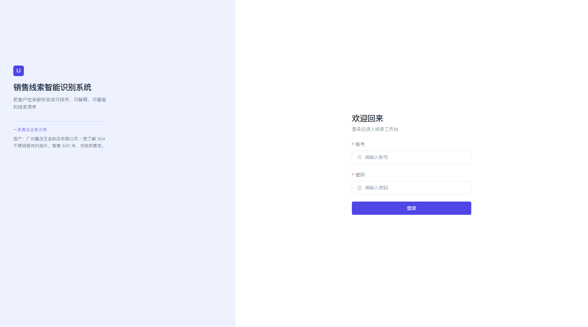
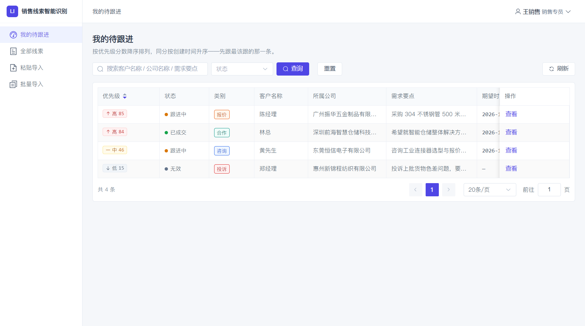
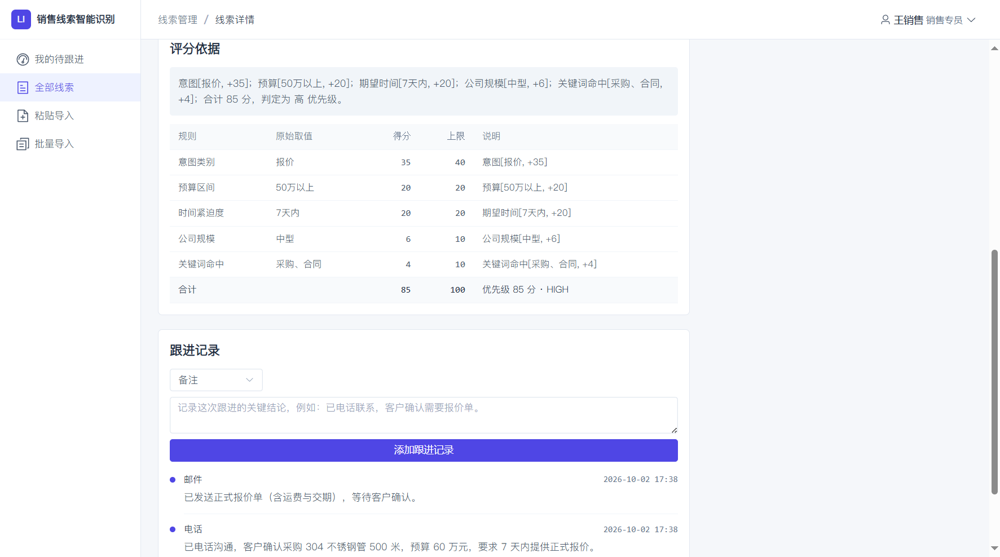
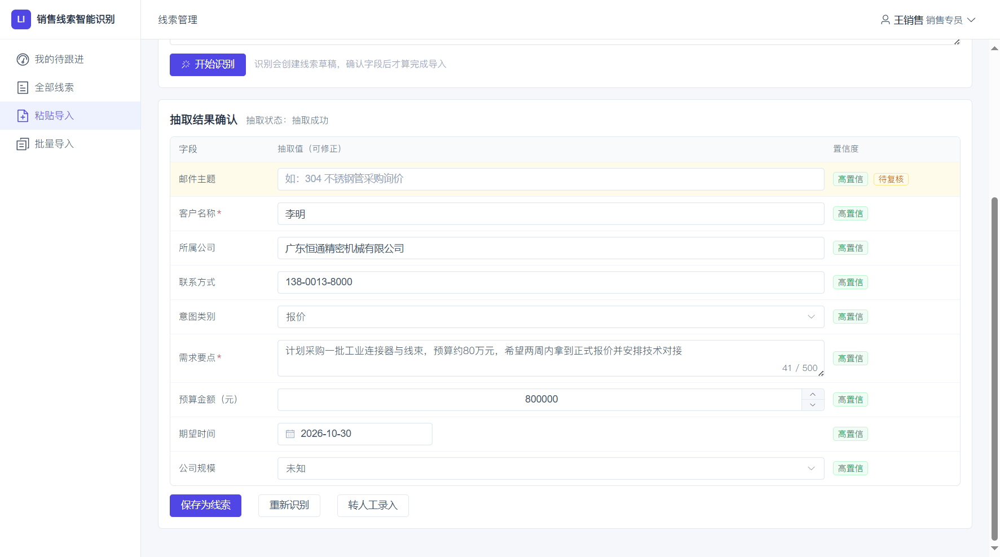
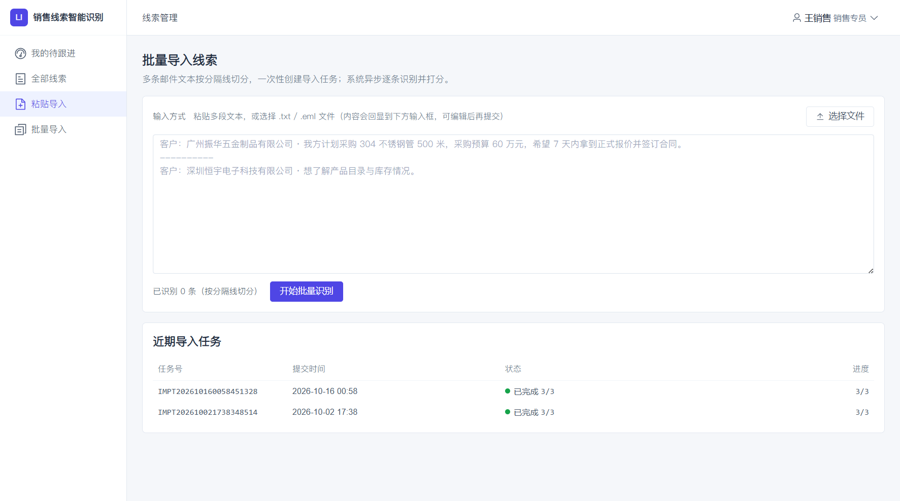
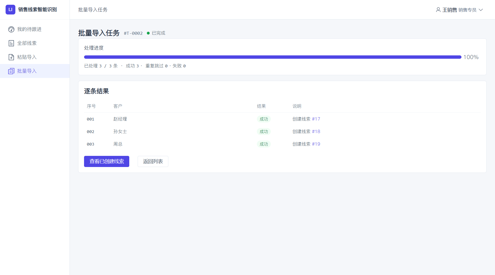
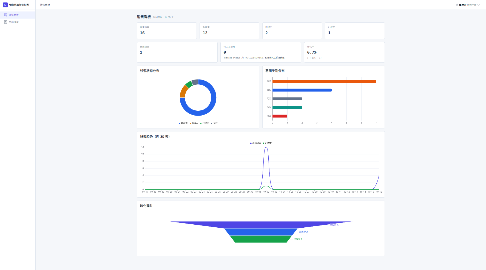

# 企业销售线索智能识别与跟进优先级排序系统


> 用大模型把「客户邮件」变成「结构化线索卡片」，再用纯规则引擎给出**可解释的优先级排序**——让销售先跟最该跟的人。

---

## 目录

- [项目背景](#项目背景)
- [功能特性](#功能特性)
- [效果预览](#效果预览)
- [技术栈](#技术栈)
- [项目结构](#项目结构)
- [快速开始](#快速开始)
- [配置分层](#配置分层)
- [核心设计](#核心设计)
- [质量与验证](#质量与验证)
- [成本与安全约束](#成本与安全约束)
- [已知局限](#已知局限)
- [开发状态](#开发状态)

---

## 项目背景

面向 B2B 中小企业的销售场景。客户询盘从邮件进来，销售需要逐封人工阅读，判断「这是报价还是投诉」「预算多少」「急不急」，再决定先跟谁。

线索一多就出三个问题：

1. **重要线索被埋在队列里**——没有统一的判断标准，跟进的先后顺序全凭手感；
2. **录入成本高**——从邮件里抄客户名、公司、预算、时间，一封信一两分钟；
3. **过程不留痕**——跟了没跟、谁跟的、结果如何，主管看不到。

本系统把这条链路自动化：**粘贴或批量导入原始文本 → 大模型结构化抽取 → 规则引擎评分排序 → 认领、跟进、推进状态全留痕**，并有看板给主管看分布与转化。

---

## 功能特性

| 模块      | 说明                                                  |
| ------- | --------------------------------------------------- |
| 身份认证与权限 | JWT 无状态鉴权；销售专员 / 销售主管双角色，前端路由守卫 + 后端方法级鉴权**双重收口**   |
| 智能信息抽取  | 调用大模型从非结构化文本中抽取客户、公司、需求要点、预算、期望时间、意图类别，输出三档置信度与缺失项  |
| 优先级评分   | 5 条规则加权合计 100 分，分档「高 / 中 / 低」；**每分都有中文依据**，详情页可逐项追溯 |
| 内容指纹去重  | 原文 6 步归一化后取 SHA-256 指纹，重复内容识别为幂等，不重复入库              |
| 线索管理    | 新增、双视图列表（我的 / 全部）、详情、编辑、删除、认领                       |
| 状态机     | 线索生命周期用枚举 + 静态迁移表实现，成交 / 无效为终态，非法迁移被拒绝              |
| 跟进记录    | 跟进历史与新增，记录跟进方式、内容与**记录人**                           |
| 批量导入    | 多行文本批量提交，异步任务处理，进度可轮询、逐条结果可查                        |
| 数据看板    | 线索总览、状态分布、类别分布、趋势（4 张图）                             |

---

## 效果预览

**① 登录**



**② 工作台线索列表**（优先级分档色标，按分数降序）



**③ 线索详情 · 评分依据**（五项规则明细，可逐条追溯）



**④ 智能抽取结果确认**（抽取值 + 置信度徽章）



**⑤ 批量导入**



**⑥ 导入任务进度**（进度条 + 逐条明细）



**⑦ 销售看板**（指标卡 + 四张图）



---

## 技术栈

版本均取自构建文件，**锁定到小版本**（不写 `latest`，避免复现时踩坑）。

### 后端

| 技术                                 | 版本                         | 用途                                       |
| ---------------------------------- | -------------------------- | ---------------------------------------- |
| Java                               | `21 (LTS)`                 | 运行时                                      |
| Spring Boot                        | `3.5.16`                   | 应用框架（内嵌容器，单体分层）                          |
| Spring Web / Validation / Security | Boot BOM 管理                | REST、参数校验、无状态安全链                         |
| MyBatis-Plus                       | `3.5.15`                   | 持久层（`mybatis-plus-spring-boot3-starter`） |
| mybatis-plus-jsqlparser            | `3.5.15`                   | 分页插件依赖（3.5.9 起从 extension 拆出，**必须显式引入**） |
| MySQL                              | `8.0`                      | 关系型数据库（`com.mysql:mysql-connector-j`）    |
| JJWT                               | `0.12.6`                   | JWT 签发与校验（HS256）                         |
| Lombok                             | Boot BOM                   | 减少样板代码                                   |
| JUnit 5 + MockMvc                  | `spring-boot-starter-test` | 单元与切片测试                                  |

### 前端

| 技术                      | 版本                    | 用途                                       |
| ----------------------- | --------------------- | ---------------------------------------- |
| Vue                     | `3.5`                 | 视图框架（Composition API + `<script setup>`） |
| TypeScript              | `5.6` + `vue-tsc 2.1` | 类型安全，类型错误**阻断构建**                        |
| Vite                    | `6.0`                 | 开发服务器与构建（含接口代理）                          |
| Element Plus            | `2.9.1`               | 企业级组件库                                   |
| @element-plus/icons-vue | `2.3.1`               | 全项目唯一图标源（矢量、禁用 emoji 作图标）                |
| Pinia                   | `3.0`                 | 状态管理（用户态、筛选态）                            |
| Vue Router              | `4.4`                 | 路由与角色守卫                                  |
| ECharts + vue-echarts   | `5.5.1` / `7.0.3`     | 看板图表                                     |
| axios                   | `1.7`                 | 请求封装、统一响应解包、401/403 分流                   |

### 智能层

DeepSeek 官方 API（OpenAI 兼容协议，JSON Output 模式）。**不做模型训练、不做数据标注**——本项目把大模型当"外部能力"用，工程价值落在**结构化契约、容错降级与可解释排序**上。

### 一些刻意的取舍

| 没用的东西                    | 为什么不用                             |
| ------------------------ | --------------------------------- |
| Spring Boot 4.x / 更高 JDK | 生态兼容性未验证，毕设周期内不值得冒风险              |
| Redis                    | 用缓存抽象层 + 进程内实现先顶住，多实例共享列为后续计划     |
| 熔断/限流中间件                 | 逻辑不复杂，且要与"失败后降级落库"的业务语义耦合，自研更透明可控 |
| 向量库 / RAG                | 本场景无检索增强需求，引入只会变成简历上的伪亮点          |
| 语义级近似去重                  | 规格冻结的是"精确指纹全等"，近似变体列为展望而非硬做       |

---

## 项目结构

```
sales-lead-intelligence-ranking/
├── lead-insight-backend/                     后端服务
│   └── src/main/
│       ├── java/com/leadinsight/
│       │   ├── module/                       业务模块（按域分包）
│       │   │   ├── auth/                     登录鉴权
│       │   │   ├── user/                     用户
│       │   │   ├── lead/                     线索（含优先级评分引擎）
│       │   │   ├── extract/                  智能抽取
│       │   │   │   ├── client/               DeepSeek 客户端与请求/响应模型
│       │   │   │   ├── llm/                  令牌桶限流、熔断、每日配额闸
│       │   │   │   ├── prompt/               提示词加载与版本校验
│       │   │   │   └── parser/               模型输出解析与校验
│       │   │   ├── importtask/               批量导入（异步执行器 + 计数）
│       │   │   ├── followup/                 跟进记录
│       │   │   └── dashboard/                看板统计
│       │   ├── security/                     JWT 过滤器、用户主体
│       │   ├── statemachine/                 状态迁移
│       │   ├── cache/                        缓存抽象（含进程内实现）
│       │   ├── config/                       安全、持久层、线程池等配置
│       │   └── common/                       统一响应、错误码、异常、工具
│       └── resources/
│           ├── application*.yml              分层配置
│           ├── db/                           建表脚本
│           ├── mapper/                       MyBatis 映射
│           └── prompt/                       抽取提示词模板（带版本）
├── lead-insight-frontend/                    前端工程
│   └── src/
│       ├── api/                              接口封装（axios 实例与拦截器）
│       ├── views/                            页面（按域分目录）
│       ├── components/                       通用组件
│       ├── composables/                      组合式逻辑（列表查询等）
│       ├── layout/                           整体布局
│       ├── router/                           路由与角色守卫
│       ├── stores/                           Pinia 状态
│       ├── styles/                           设计令牌与全局样式
│       └── types/   utils/   mocks/
├── assets/screenshots/                       界面截图（README 引用）
├── .gitleaks.toml                            密钥扫描规则
├── .github/workflows/                        CI（每次推送做密钥扫描）
└── .gitignore
```

---

## 快速开始

### 环境要求

| 依赖      | 版本   |
| ------- | ---- |
| JDK     | 21   |
| Maven   | 3.9+ |
| Node.js | 18+  |
| MySQL   | 8.0  |

### 后端

```bash
cd lead-insight-backend

# 1) 建库（注意用 utf8mb4，否则中文与种子数据会静默失败）
mysql -u root -p -e "CREATE DATABASE lead_insight DEFAULT CHARACTER SET utf8mb4 COLLATE utf8mb4_general_ci;"

# 2) 导入表结构。两个脚本必须按顺序执行且都要跑：
#    第一个脚本会重建部分表，第二个脚本负责其中一张明细表
mysql -u root -p --default-character-set=utf8mb4 lead_insight < src/main/resources/db/schema-v1.1.sql
mysql -u root -p --default-character-set=utf8mb4 lead_insight < src/main/resources/db/import_task_item.sql

# 3) 按需修改数据库连接（见「配置分层」；开发环境可沿用 application-dev.yml 默认值）

# 4) 启动，默认端口 8080
mvn spring-boot:run
```

打包运行：

```bash
mvn clean package
java -jar target/lead-insight-backend-1.0.0.jar
```

### 前端

```bash
cd lead-insight-frontend
npm install
npm run dev      # 开发服务器，接口默认代理到本机后端
npm run build    # 先做类型检查，再产出生产构建
```

浏览器打开开发服务器地址，用演示账号登录（首次启动时自动创建，分专员与主管两个角色）。账号口令见交付文档《使用手册》，**不随仓库公开**——登录页与 README 都不列明文口令。

### 启用大模型抽取（可选）

**不配置也能完整启动运行**。未配置密钥时，抽取自动降级为「待人工处理」：线索照常入库、可认领可跟进，只是抽取字段为空——**模型不可用 ≠ 系统不可用**。

启用方式二选一：

```bash
# 方式一：环境变量
export DEEPSEEK_API_KEY=你的密钥
```

```yaml
# 方式二：在 lead-insight-backend/ 下新建 application-local.yml
llm:
  api-key: 你的密钥
```

> `application-local.yml` 已在 `.gitignore` 中，不会进版本库。

---

## 配置分层

配置按用途拆层，真实密钥一律不进版本库。

| 文件                      | 是否入库               | 用途              |
| ----------------------- | ------------------ | --------------- |
| `application.yml`       | 是                  | 公共配置，不含任何密钥     |
| `application-dev.yml`   | 是                  | 本地开发默认值         |
| `application-prod.yml`  | 是                  | 生产模板，敏感项全部走环境变量 |
| `application-local.yml` | **否**（已 gitignore） | 本地真实密钥与个人覆盖项    |

生产环境必须外部注入：`DB_URL`、`DB_USERNAME`、`DB_PASSWORD`、`JWT_SECRET`、`DEEPSEEK_API_KEY`。

---

## 核心设计

### 1. 结构化抽取 + 四级降级容错

抽取走「JSON 输出模式 + 严格解析校验」，失败按**固定次数重试**，仍失败则落为「转人工」并把原文完整保留——不丢数据、不无限重试。

成本与稳定性上叠了四层：

```
① 模型白名单（启动期校验，配置成白名单外的模型直接启动失败）
② 按账户的日额度闸（每账户每日 10 次；用满即封禁该账户与其来源 IP 7 天）
③ 令牌桶限流（容量 10 突发 + 1 QPS 恢复）
④ 熔断 + 重试（连续失败达阈值即熔断，冷却后自动恢复）
```

模型故障时的行为是**降级而非报错**：线索仍然可认领、可跟进、可推进状态。

### 2. 内容指纹幂等去重

同一封邮件被重复导入是常态，所以去重放到了数据层：

- **6 步归一化**：换行统一 → 转小写 → 行级清洗（去空行与引用行）→ 全角空格处理 → 空白折叠 → SHA-256；
- **两层兜底**：入库前先查指纹，命中直接返回"内容重复"；数据库唯一索引兜住并发；
- **反向边界**：归一化不能"做过头"——正文只差一个数字（如预算 50 万 vs 45 万）必须是不同指纹，这类反向用例随构建跑绿。

### 3. 可解释的优先级排序

| 维度   | 满分 | 依据                          |
| ---- | -- | --------------------------- |
| 意图   | 40 | 抽取结果（报价 / 合作权重高，投诉低，无关为 0）  |
| 预算   | 20 | 抽取金额，分档给分                   |
| 期望时间 | 20 | 抽取时间（**相对表述会按当前日期换算为绝对日期**） |
| 公司规模 | 10 | 抽取结果                        |
| 关键词  | 10 | 纯规则扫描原文，**不依赖模型**           |

- 分档：`≥70` 高 / `40–69` 中 / `<40` 低；
- 详情页逐项列出中文依据（如「意图[报价,+35]；预算[50万以上,+20]…」），**五项之和恒等于总分**，可逐条追溯；
- 被判为「无关」的邮件强制置零，并标注不参与排序。

### 4. 批量异步导入 + 进度可查

提交即返回任务号，抽取在线程池里异步跑；前端按秒轮询进度，到终态自动停止。三级结果（成功 / 去重 / 转人工）**之和恒等于提交总数**——这个自洽校验既是给用户看的，也是给自己写测试用的。

---

## 质量与验证

| 项       | 数据                                    |
| ------- | ------------------------------------- |
| 后端代码规模  | 126 个 Java 文件 / 7358 行（主源码）           |
| 后端自动化测试 | **24 个测试类 / 158 个用例，0 失败 0 错误 0 跳过**  |
| 前端代码规模  | 50 个文件 / 6425 行                       |
| 前端类型检查  | `vue-tsc --noEmit` 0 error（已接入构建前置门禁） |
| 端到端走查   | 三轮累计 **48 条判据**，逐条留执行记录               |
| 效果评测    | 40 条人工标注样本跑批，见下表                      |

**40 条金标准样本跑批结果**（修复后的终版数据）：

| 指标 | 结果 |
| --- | --- |
| ① 字段级抽取准确率（四字段） | **92.9%**（79/85；其中客户名称 / 所属公司 / 预算三类 **100%**） |
| ② 意图分类准确率 | **95.0%**（38/40） |
| ③ 幻觉率 | **30.0%**（12/40，即抽出的字段在原文中找不到依据的比例） |
| ④ 排序可用性 | **40%**（4/10 样本能进入高优先级档位） |
| ⑤ 同内容去重 | **100% 无误杀**（40/40 指纹非空且互异） |
| 运行稳定性 | 熔断 / 降级 **0 / 0**（43 次真实调用全部有响应） |

> 评测只统计"同内容重复"的拦截能力；同义改写这类近似变体属能力边界，未纳入指标，见「已知局限」。

---

## 成本与安全约束

大模型调用按量计费，系统内置四层成本防护（见「核心设计 1」），防止误用与失控。

额度按**账户**计量，不按站点总量：每个账户每自然日 10 次抽取（`llm.quota.daily-limit`），不同账户互不挤占。单日用满后，**该账户**被禁止消耗模型额度 7 天（`llm.quota.ban-days`）。封禁落库（表 `llm_quota_ban`），重启不清零，到期自动解除。

来源 IP 不做"一个人犯错、整片出口停摆"的连坐：只有当同一 IP 上**已被封禁的不同账户数达到 3**（`llm.quota.ip-ban-min-accounts`）时才封该 IP——一个人开三个号刷会被拦下，而公司/校园共用一个出口 NAT 时，一个人的失控不会波及同事。账户封禁不受此阈值影响。

两个刻意的取舍写在配置注释里：本机/内网地址默认不落 IP 封禁（否则开发演示一次用满就把整台机器锁一周，`llm.quota.ban-local-ip`）；代理头 `X-Forwarded-For` 默认不采信（可被客户端伪造，采信等于让攻击者自己决定封哪个 IP，`app.security.trust-forwarded-for`）。

取址只用容器填的 `remoteAddr`（由 TCP 连接决定，客户端改不了），并兼容 `ip:port`、`[IPv6]:port`、裸 IPv6 三种形态；封禁键**只取 IP 不取端口**——同一台机器每个连接的源端口都不同（NAT 后更是天天变），拿端口当键等于每次换一个键，谁也封不住。

密钥防泄露采用三道防线：

| 防线    | 位置             | 作用                 |
| ----- | -------------- | ------------------ |
| 提交前钩子 | `pre-commit`   | 扫描暂存区，命中密钥即阻断提交    |
| 推送前钩子 | `pre-push`     | 全历史扫描，命中即阻断推送      |
| CI 兜底 | GitHub Actions | 每次推送后自动扫描，防止绕过本地钩子 |

另有构建期检查：把密钥文件放进资源目录会直接导致构建失败，从流程上堵住"打包时把密钥打进产物"。

---

## 已知局限

诚实清单，也是后续可改进项：

| 局限            | 说明                                                       |
| ------------- | -------------------------------------------------------- |
| 投诉类线索难以进入高优先级 | 评分权重设计上，投诉意图分值低且通常无预算，理论上限够不到高档位——这是**权重取舍**，已在论文中作为边界讨论 |
| 不做语义级近似去重     | 同义改写、排版大改的邮件不会被判重（超出精确指纹能力）                              |
| 外币金额不换算       | 非人民币预算在预算维度不加分                                           |
| 缓存与熔断为进程内状态   | 单实例无影响；多实例部署需引入共享存储                                      |
| 前端构建体积        | 图表库未做按需裁剪                                                |
| 生产部署          | 部署方案与步骤已备，尚未在真实服务器上验证                                    |

---

## 开发状态

毕业设计项目（单人完成），功能已按规划实现并完成端到端走查与效果评测，持续完善中。


开发过程遵循两条纪律：**契约先行**（接口结构先改契约再动代码）与**留痕可查**（缺陷必须能追溯到具体提交与验证方式）。这也是上表那些数字能被复核的原因。

**关于 AI 辅助**：脚手架与重复性代码借助 AI 工具生成；架构设计、表结构与接口契约、业务分层、单元测试由本人完成。所有 AI 产出均经 24 个测试类 / 158 个用例与三轮走查验证后才进入主干，上述数字即为验证结果。

欢迎提 Issue 交流。

---

## 许可

本项目仅用于学习与研究，未附开源许可证，请勿直接用于生产环境。
